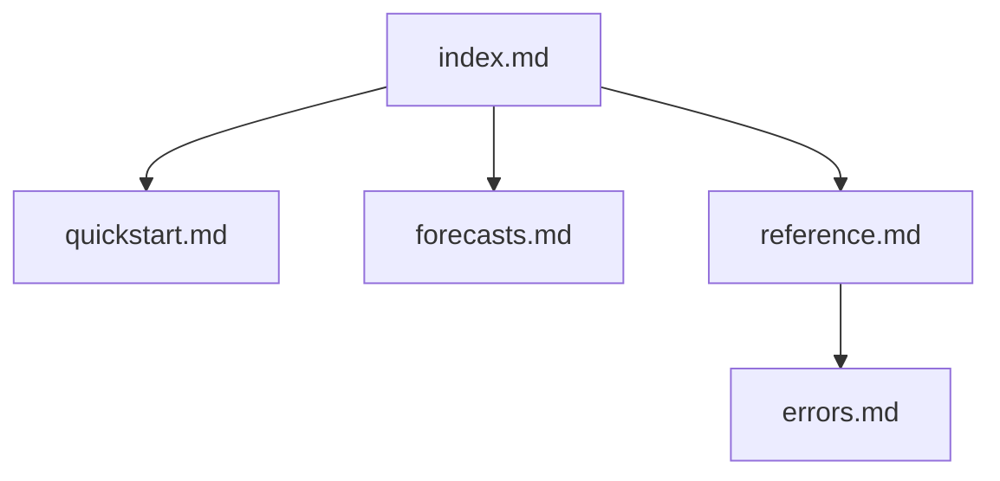
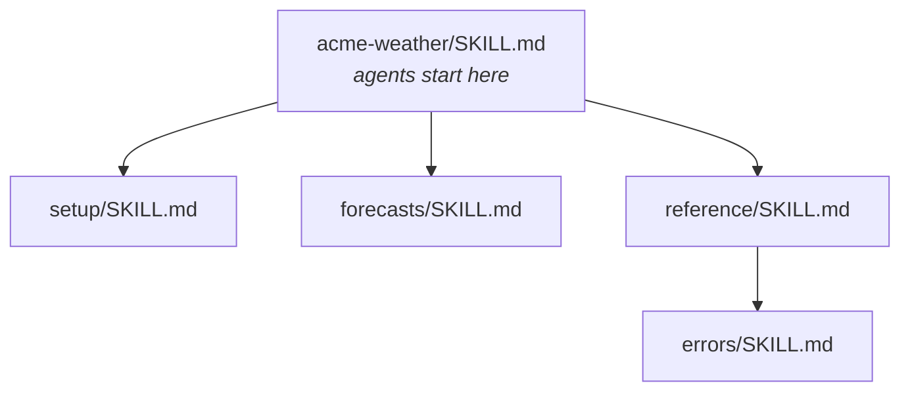
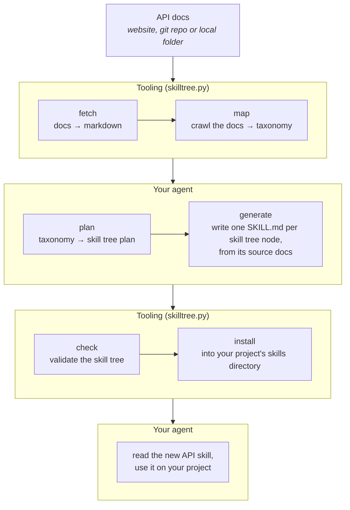

# iskillz

**Turn API docs into API-usage skills for agents.**

**iskillz** is an [agent skill](https://agentskills.io) for making **new skills** from **API docs**, for agents to become **experts** on using those APIs.

 **Main reason** for using this skill would be:

*"I have a project using one or more APIs, and need new skills that will make my coding agents experts on those APIs"*

This skill will make possible generating new skills for:

- Libraries and SDK's
- REST APIs
- AGENTS.md and their referenced documents
- And more... 😉

## From API docs to API skill

An example for a made-up *Acme Weather* API.

**Prompt** (to your agent)

> Use **iskillz** to make an API skill for the Acme Weather API from
> https://docs.example.com/acme-weather/index.md and install it 
> in this project for you to use.

**Input: API docs**



**Output: API skill**



## How it works

In broad terms, the agent given **iskillz** will use its tooling to:

- Get the **root document** for the target API docs.
- Analyze them and build a **taxonomy** for those.
- From this one, **derive a new taxonomy** for a new **API skill**.
- Build the required **SKILL.md documents** and **organize** them accordingly.

The **creation pipeline** would be as follows:



## Installation

These are required both for installing and using **iskillz**:

- [Python 3.11+](https://www.python.org/downloads/), used for running the python scripts on the skill.
- [git](https://git-scm.com/downloads), to fetch docs from repositories.
- A skill-capable agent (Claude Code, Qwen Code, Codex, ...). 

The installation process will copy the required **iskillz** files and scripts to agents skills directories, and run a `bootstrap.py` script  **when first used**, in order to **install** the required python dependencies on a private `~/.cache/iskillz/venv.

### Method 1: installer (recommended)

Needs `curl` (preinstalled on macOS and most Linux).

**For a single project,** run at your project's directory:

```sh
curl -fsSL https://raw.githubusercontent.com/anteloc/iskillz/master/install.sh | sh
```

This will copy **iskillz** skill under every `.<agent>/skills` directory present, like e.g. `.claude/skills` or `.codex/skills`.

If no skills directory present, it will create a new `.claude/skills` by default.

**For all your projects,** add a `--global` flag, run from any directory:

```sh
curl -fsSL https://raw.githubusercontent.com/anteloc/iskillz/master/install.sh | sh -s -- --global
```

This installs **iskillz**  globally to your personal skill directories (`~/.claude/skills/`, ...), making it available to your agents on every project.

**For a specific agent**, like e.g. Qwen Code:

```sh
curl -fsSL https://raw.githubusercontent.com/anteloc/iskillz/master/install.sh | sh -s -- --agent qwen
```

All installer options, passed after `sh -s --`:

| Option         | Does                                                                          |
| -------------- | ----------------------------------------------------------------------------- |
| `DIR`          | install into that project instead of the current directory                    |
| `--global`     | install into your personal skill directories                                  |
| `--agent NAME` | repeatable, add one per target agent: `agents`, `claude`,  `qwen`, `codex`... |
| `--ref REF`    | install a branch, tag or commit (default: `master`)                           |
| `--force`      | replace a pre-existing `.<agent>/skills/iskillz/` installation                |

### Method 2: skills CLI

Needs [Node.js](https://nodejs.org/) (for `npx`). 

Run from your project's root:

```sh
npx skills add anteloc/iskillz
```

This will install the skill under `.agents/skills`

Then, symlink from other agents dirs if you need to, like e.g.:

```
mkdir -p .claude/skills && cd .claude/skills
ln -s ../../.agents/skills/iskillz iskillz
```
## Usage Examples

If your agent doesn't detect the new skill, exit your current chat session and start a new one.

These are some different ways to produce new API skills:

### Point to an API index

For example, in a robotics project:

> We're going to simulate our robot arm with MuJoCo. Use **iskillz** to make a
> skill for the MuJoCo API from https://mujoco.readthedocs.io/en/stable/overview.html
> and install it in this project.

### Point to docs in a GitHub repo

It will find the API index and move forward from there:

> Use **iskillz** to make a skill for the Click API from
> https://github.com/pallets/click/tree/main/docs and install it in this project.

### Let the agent find the docs

The agent will scan a repo to find and collect the required API docs:

> Find the API docs for the Moonshine Voice SDK in
> https://github.com/moonshine-ai/moonshine and their entry point. Then use
> **iskillz** to make an API skill from them and install it in this project.

### Just give it a task

When a need for a missing API skill is detected, it will offer to build one before starting:

> Add a script that loads models/arm.xml with mujoco and steps the simulation
> for 5 seconds.


## Structure

```
iskillz/
├── skills/iskillz/          # the skill itself: all that gets installed
│   ├── SKILL.md             # how to run the pipeline
│   ├── scripts/
│   │   ├── skilltree.py     # fetch | map | plan | generate | check | package | install | build
│   │   ├── docsource.py     # fetch: local / git / website docs -> markdown (pandoc)
│   │   ├── bootstrap.py     # first run: installs requirements.txt into a private virtualenv
│   │   └── requirements.txt # runtime Python packages
│   ├── references/
│   │   ├── planning.md      # agent rules: docs taxonomy -> skill tree plan
│   │   ├── writing.md       # agent rules: writing one SKILL.md
│   │   └── adding-tools.md  # how to add and register new tools
│   ├── LICENSE              # copy of the root license, shipped with the skill
│   └── CC-BY-SA-4.0         # copy of the root license, shipped with the skill
├── install.sh               # one-line installer into a project
├── examples/moonshine/      # worked example on the Moonshine Voice docs
├── pyproject.toml           # dev environment (optional, uv)
├── LICENSE                  # AGPL-3.0 (code)
└── CC-BY-SA-4.0             # CC BY-SA 4.0 (documentation/research)
```

## Develop

WIP

## License

- Code: [AGPL-3.0](LICENSE)
- Documentation and research material: [CC BY-SA 4.0](CC-BY-SA-4.0)