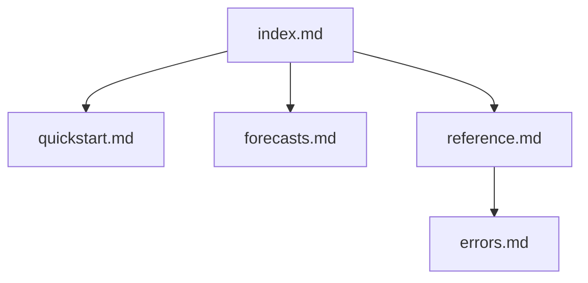
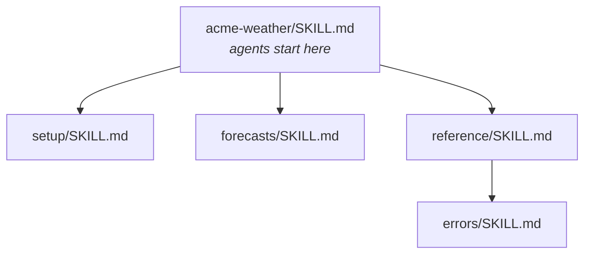

# iskillz

**Turn API docs into API skills.**

**iskillz** is an [Agent Skill](https://agentskills.io) that makes new skills.
Point your agent at an API's docs index, and **iskillz** turns them into an
**API skill**: a new skill your agent loads whenever it works with that API,
e.g. to:

- write code that calls it
- answer questions about it
- fix errors it throws

It works with APIs such as:

- libraries and frameworks, e.g. [Click](https://click.palletsprojects.com/) for Python
- SDKs, e.g. Moonshine Voice (see [examples/moonshine/](examples/moonshine/))
- engines with APIs in several languages, e.g. [MuJoCo](https://mujoco.org/) (C and Python)

| | What it is |
| --- | --- |
| **iskillz** | This skill. It will enable your agents to make new API skills. |
| **API docs** | The input: an API's documentation, starting at its index page (`.md`, `.rst` or `.html`), from a website, a git repo or a local folder. |
| **API skill** | The output: a new skill for that API, installed in your project. |

## From API docs to API skill

An example with a made-up *Acme Weather* API.

**Input: API docs** (the root index can be `index.md`, `index.rst` or `index.html`)



**Prompt** (to your agent)

> Use **iskillz** to make an API skill for the Acme Weather API from
> https://docs.example.com/acme-weather/index.md and install it in this project.

**Output: API skill**



## How it works

1. Install **iskillz** in your project, or globally.
2. Ask your agent to create a new API skill for an API, and give it the API
   docs' entry point, e.g. a GitHub URL.
3. Your agent uses **iskillz** to fetch the docs and turn them into a new API
   skill, tailored to that API, then installs it in your project (e.g.
   `.claude/skills/acme-weather/`). It takes a few minutes.

## Where to use it

| Where | How |
| --- | --- |
| Agent session in a terminal (Claude Code, Qwen Code, Codex, ...) | Ask in plain words (see [Usage Examples](#usage-examples)) |
| Agent in your editor (e.g. Claude Code in VS Code or JetBrains) | Same: ask in the chat panel |

## Installation

Every method needs these on your machine (check with `python3 --version` and
`git --version`):

- [Python 3.11+](https://www.python.org/downloads/). The skill installs its
  own Python packages into a private virtualenv (`~/.cache/iskillz/venv`) the
  first time it runs. Nothing else to install.
- [git](https://git-scm.com/downloads), to fetch docs from repositories.
- An agent that uses skills (Claude Code, Qwen Code, Codex, ...). It is
  the one that writes the API skills.

### Method 1: installer (recommended)

Needs `curl` (preinstalled on macOS and most Linux).

**Into one project.** From the root of your project:

```sh
curl -fsSL https://raw.githubusercontent.com/anteloc/iskillz/master/install.sh | sh
```

It copies the skill into each agent directory the project has (`.agents/`,
`.claude/`, `.codex/`, ...), or `.claude/` if there is none. It also sets up
its Python packages. Run it again to update.

**For all your projects.** Same command, plus `--global`, from any directory:

```sh
curl -fsSL https://raw.githubusercontent.com/anteloc/iskillz/master/install.sh | sh -s -- --global
```

It installs into your personal skill directories (`~/.claude/skills/`, ...),
so every project sees the skill.

**To pick the agent directory**, e.g. Qwen Code:

```sh
curl -fsSL https://raw.githubusercontent.com/anteloc/iskillz/master/install.sh | sh -s -- --agent qwen
```

All installer options, passed after `sh -s --`:

| Option | Does |
| --- | --- |
| `DIR` | install into that project instead of the current directory |
| `--global` | install into your personal skill directories |
| `--agent NAME` | agent directory: `claude`, `agents`, `qwen`, `codex`, `gemini`, `opencode` (repeatable) |
| `--ref REF` | install a branch, tag or commit (default: `master`) |
| `--force` | replace an `iskillz/` folder the installer did not create |

### Method 2: skills CLI

Needs [Node.js](https://nodejs.org/) (for `npx`). From the root of your
project:

```sh
npx skills add anteloc/iskillz
```

Follow its prompts to choose the agents to install for.

## Usage Examples

One use case: you need an API skill for an API. Start a new agent session in
your project (so it loads **iskillz**) and ask for it, in any of these ways.

### Name the API and where its docs are

For example, in a robotics project:

> We're going to simulate our robot arm with MuJoCo. Use **iskillz** to make a
> skill for the MuJoCo API from https://mujoco.readthedocs.io/en/stable/overview.html
> and install it in this project.

### Point to docs in a GitHub repo

> Use **iskillz** to make a skill for the Click API from
> https://github.com/pallets/click/tree/main/docs and install it in this project.

### Let the agent find the docs

Only know the SDK's repo? Ask the agent to find its API docs and their entry
point (the root doc) first:

> Find the API docs for the Moonshine Voice SDK in
> https://github.com/moonshine-ai/moonshine and their entry point. Then use
> **iskillz** to make an API skill from them and install it in this project.

### Just give it a task

It also works without asking for it by name. Give it a task that needs an API
it has no skill for, and it offers to build one first:

> Add a script that loads models/arm.xml with mujoco and steps the simulation
> for 5 seconds.

### What happens next

The agent fetches the docs, builds the API skill in `~/.cache/iskillz/mujoco`,
installs it next to **iskillz** (e.g. `.claude/skills/mujoco/`) and reads it before
carrying on. It takes a few minutes. Commit the API skill folder to share it
with your team.

This is the same whichever way you installed **iskillz**: even when it is
installed for all your projects, the API skill is installed into the project
you are working in.

## Structure

```
iskillz/
├── SKILL.md                 # the skill: how to run the pipeline
├── install.sh               # one-line installer into a project
├── scripts/
│   ├── skilltree.py         # fetch | map | plan | generate | check | package | install | build
│   ├── docsource.py         # fetch: local / git / website docs -> markdown (pandoc)
│   ├── bootstrap.py         # first run: installs requirements.txt into a private virtualenv
│   └── requirements.txt     # runtime Python packages
├── references/
│   ├── planning.md          # agent rules: docs taxonomy -> skill tree plan
│   ├── writing.md           # agent rules: writing one SKILL.md
│   └── adding-tools.md      # how to add and register new tools
├── examples/moonshine/      # worked example on the Moonshine Voice docs
├── pyproject.toml           # dev environment (optional, uv)
├── LICENSE                  # AGPL-3.0 (code)
└── CC-BY-SA-4.0             # CC BY-SA 4.0 (documentation/research)
```

## Develop

Run the scripts with `python3 scripts/skilltree.py ...`: no setup needed.
Runtime packages are listed in `scripts/requirements.txt`; `pyproject.toml`
mirrors them for an optional [uv](https://docs.astral.sh/uv/) dev environment
(`uv sync`). To add a new tool, follow
[references/adding-tools.md](references/adding-tools.md).

## License

- Code: [AGPL-3.0](LICENSE)
- Documentation and research material: [CC BY-SA 4.0](CC-BY-SA-4.0)